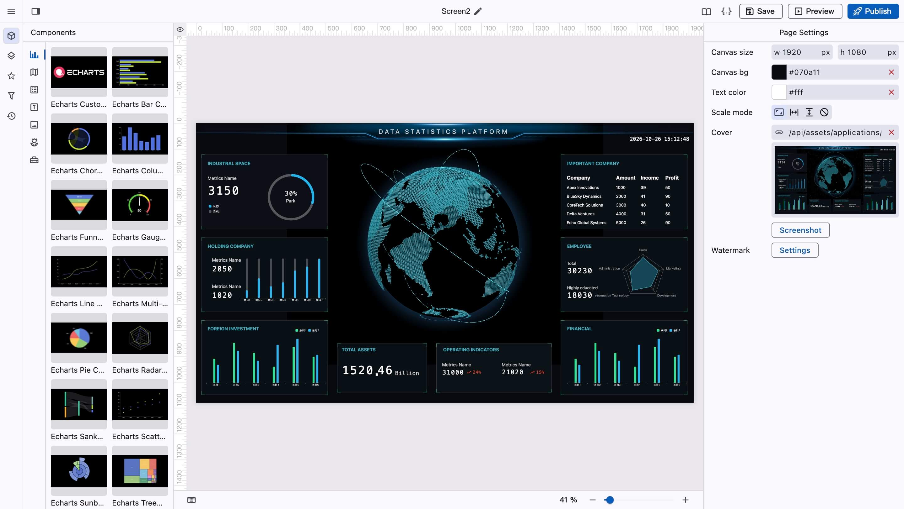
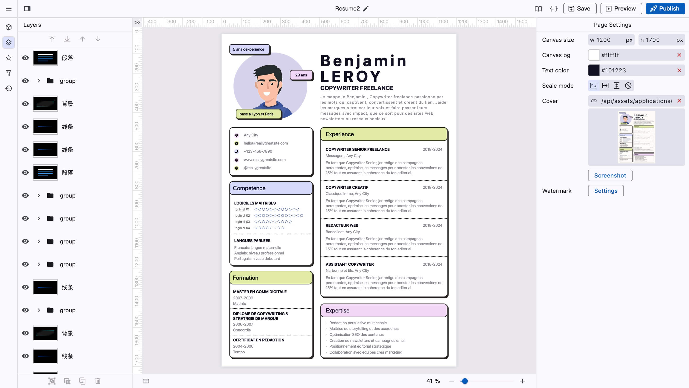

# 👋 Introduction

Acrodata Visapp is a data visualization application that allows you to quickly create data dashboards or other data panels.

<figure><figcaption></figcaption></figure>

In addition, you can also create design works such as personal resumes, posters, and more.

<figure><figcaption></figcaption></figure>
