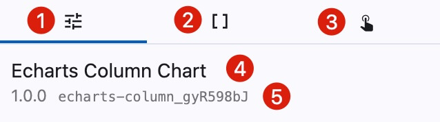

# Component Settings

<figure></figure>

After selecting a single component, the right panel displays component settings.

1. **Basic Settings**: Includes component dimensions, position, rotation angle, opacity, and custom configuration options
2. **Data Settings**: Configure component data sources, supporting multiple source types including static data, random data, API, CSV, and databases
3. **Interaction Settings**: Configure interaction relationships between components, including interaction events and actions
4. **Component Alias**: Double-click the component name in the layer panel to rename it
5. **Component Information**: Displays the component version and unique ID