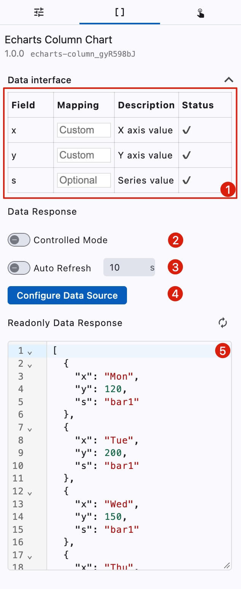

# Data Settings

<figure></figure>

1. Data field mapping
2. **Controlled Mode**: When enabled, the component will not automatically request data on initialization; data requests must be triggered by component interactions or timers
3. **Auto Refresh**: Continuously requests the API at the specified time interval
4. Component data source configuration button
5. Component response data (read-only, not editable)