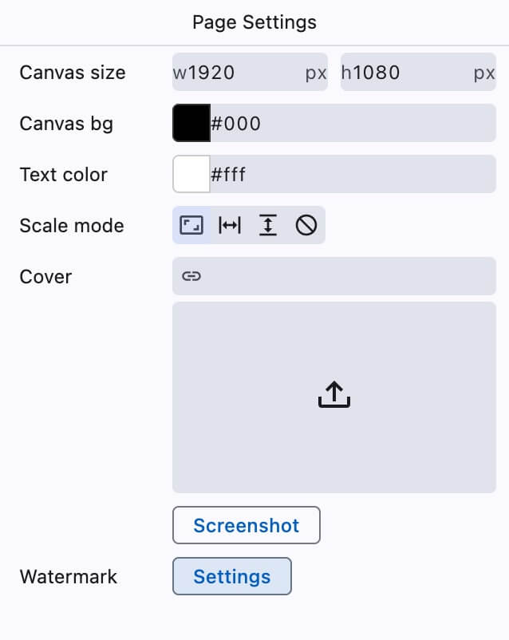
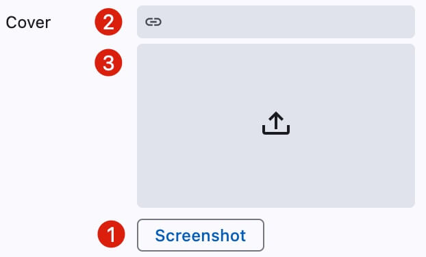

# Page Settings

<figure></figure>

When no component is selected, the right panel displays page settings.

Page settings include canvas size, canvas background, text color, and other options.

### Upload Cover

<figure></figure>

Three methods are provided for uploading cover images:
1. Click the screenshot button to quickly capture the canvas area
2. Enter an image URL (or use system screenshot and press `Ctrl+V` to paste)
3. Click the upload button to select a local image