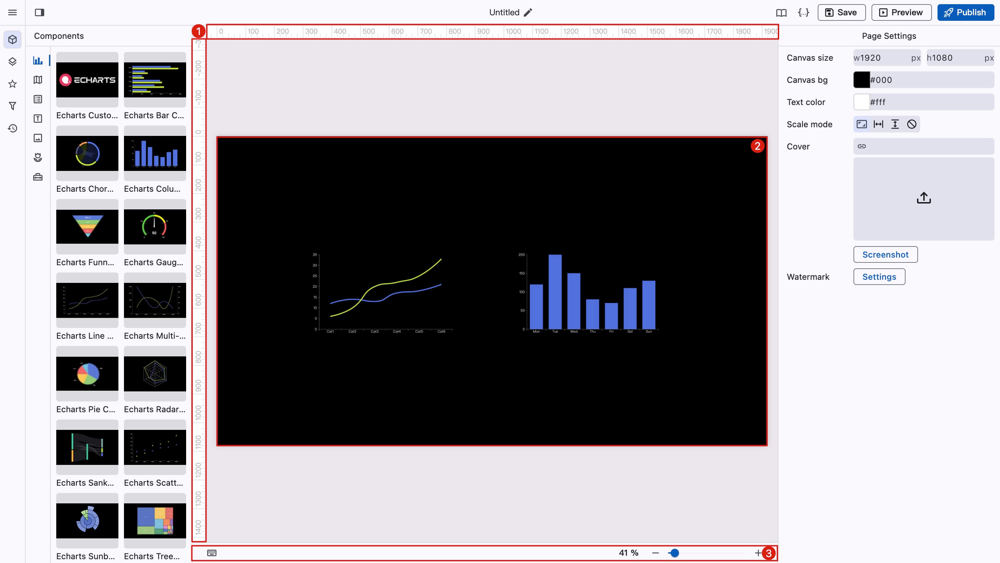
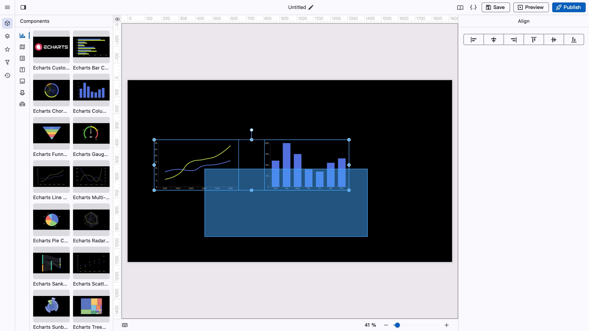
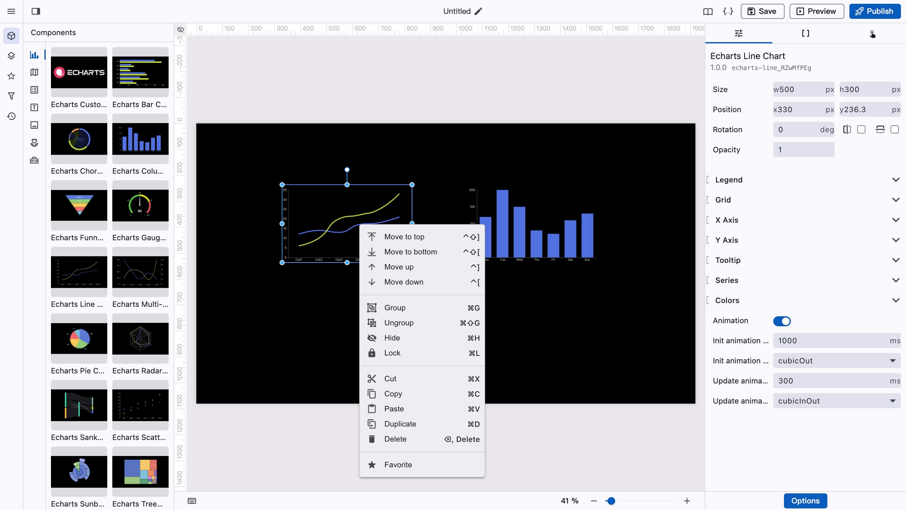
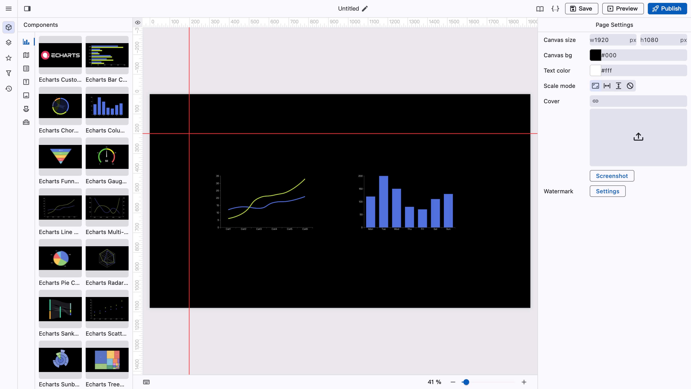

# 工作区

<figure><figcaption></figcaption></figure>

工作区包括标尺、画布、操作栏。

### 画布

在画布中允许对组件进行拖拽、缩放、旋转、框选等。

<figure><figcaption></figcaption></figure>

<figure><figcaption></figcaption></figure>

### 标尺

<figure><figcaption></figcaption></figure>

按住按标尺可以拖出辅助线，双击辅助线可以将其删除，点击左上角的小眼睛图标可以隐藏辅助线。

### 操作栏

操作栏提供了缩放画布的按钮，建议直接使用快捷键操作。
