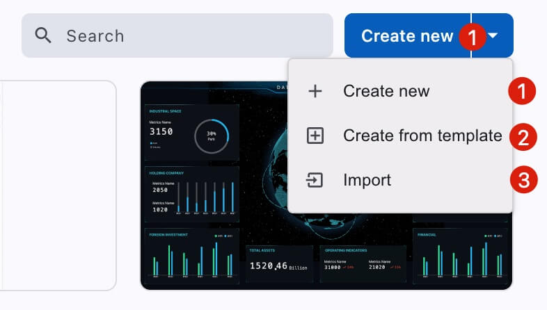
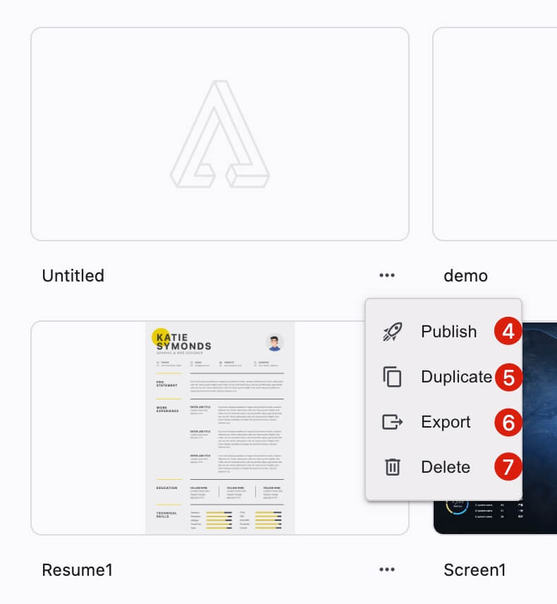
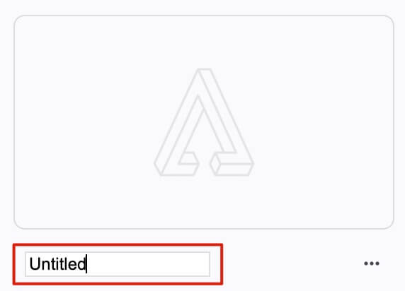

# 我的文件

<figure><figcaption>
创建
</figcaption></figure>

<figure><figcaption>
操作
</figcaption></figure>

1. 快速创建
2. 从模板创建
3. 导入
4. 发布
5. 复制
6. 导出
7. 删除

### 重命名

<figure><figcaption></figcaption></figure>

双击文件名称可以重命名。
