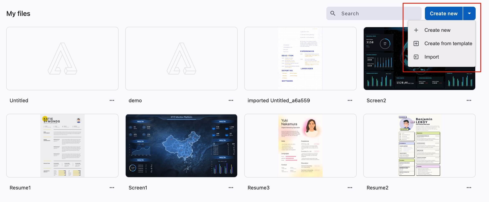
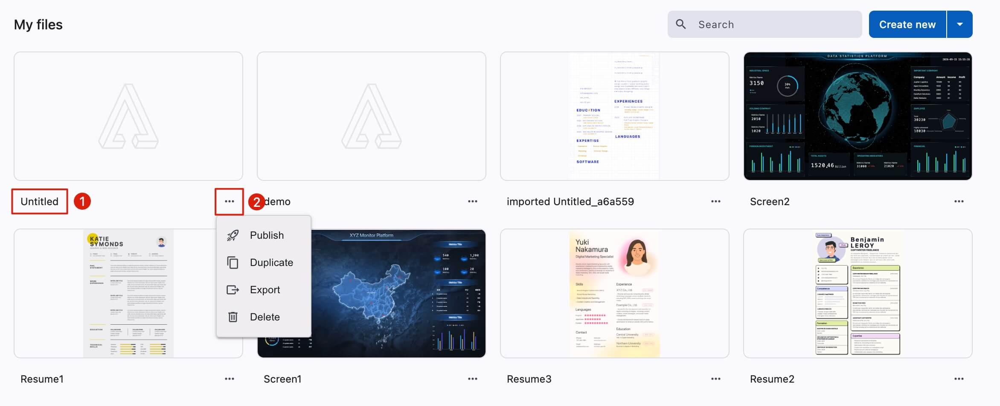

# 我的文件

### 创建应用

<figure><figcaption></figcaption></figure>

创建应用支持以下三种方式：

1. **快速创建**：生成一个默认名称为"未命名"的应用，并立即跳转至编辑模式
2. **从模板创建**：可选择系统内置模板，或使用自定义模板
3. **导入文件**：仅允许导入之前导出的应用文件

### 操作说明

<figure><figcaption></figcaption></figure>

1. **重命名**：双击文件名即可修改应用名称
2. **操作菜单**：点击操作按钮展开下拉菜单，查看可用操作
