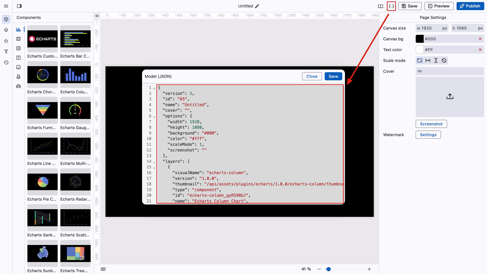
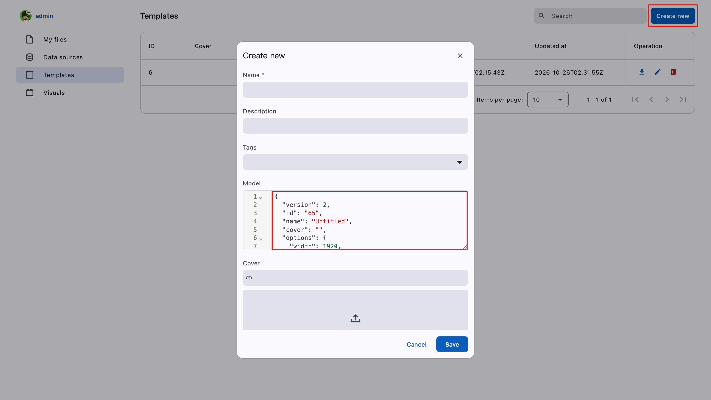

# 模板

在模板页面，可以添加自定义模板，仅用户自己可见。

首先进入可视化编辑，点击“查看配置数据”，复制 JSON 数据。

<figure><figcaption></figcaption></figure>

点击“创建”按钮，将拷贝到数据复制到“Model”字段中。

<figure><figcaption></figcaption></figure>

填写其它必要字段，然后保存。

在应用列表页，选择“从模板创建”可以看到自己创建的模板。
