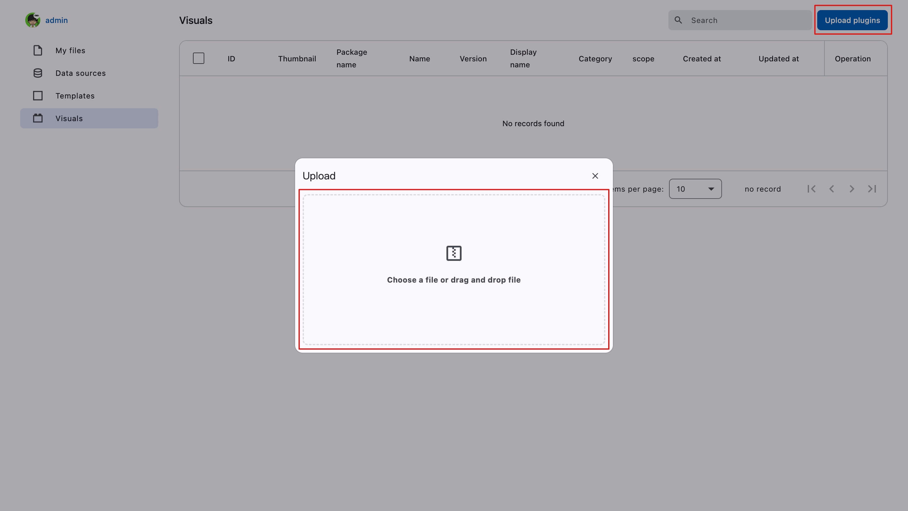

# Visual Plugins

On the visual plugins page, you can upload developed plugin packages or modify part of the plugin information.

<figure><figcaption></figcaption></figure>

After packaging the plugin, a ZIP file will be automatically generated. Select the ZIP file to upload it. For detailed plugin development instructions, please refer to the [Custom Plugin](../reference/custom-component.md) documentation.